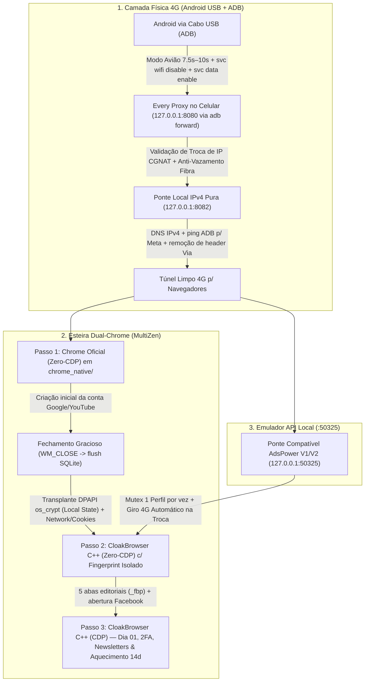

# MultiZen 4G Conveyor — Rotação 4G ADB + Ponte IPv4 Pura + Esteira Dual-Chrome

Pacote técnico desacoplado e higienizado contendo toda a camada de **Infraestrutura 4G USB (ADB + Every Proxy + Ponte IPv4 `:8082`)**, o gerenciador local de perfis isolados **MultiZen (`multizen.js`)**, o **Livro-Razão de Colisão de IPs CGNAT (`incogniton.js`)** e a **Esteira de Criação & Aquecimento em 3 Passos (`modules/account_warmup/`)**.

---

## 1. Visão Geral da Arquitetura



---

## 2. Estrutura de Arquivos do Repositório

| Caminho | Responsabilidade Técnica |
| :--- | :--- |
| `multizen.js` | Motor principal de perfis isolados em SQLite nativo (`node:sqlite` Node 22.5+), abertura em `Zero-CDP` ou `CDP`, semente de `VariationsSeedV2`/`TrustTokenKeyCommitments`, migração DPAPI `os_crypt` + `Cookies` do Chrome Oficial para o CloakBrowser C++ (`migrateNativeChromeToCloakBrowser`) e higienização pré-launch (`sanitizeMultiZenDiskBeforeLaunch`). |
| `incogniton.js` | Gerenciador de sessão unificado, scanner de locks de kernel, trava de sessão diária 4G e **Livro-Razão de IPs (`account_ip_ledger.json`)** que impede duas contas diferentes de reutilizarem o mesmo IP CGNAT recente. |
| `modules/infra_4g/adb_rotator.js` | Controle via ADB do aparelho Android USB: alternância de Modo Avião (`7.5s`/`10s`), desligamento forçado de Wi-Fi (`svc wifi disable`), ativação de dados móveis (`svc data enable`), `adb forward tcp:8080 tcp:8080` e limpeza de cache DNS. |
| `modules/infra_4g/ipv4_proxy_bridge.js` | Servidor proxy local em `127.0.0.1:8082` conectado ao `Every Proxy` (`127.0.0.1:8080`). Resolve domínios exclusivamente em IPv4 (e via `adb shell ping -c 1` na interface móvel para domínios Meta), envia `CONNECT <IPv4>:443` para eliminar vazamento de sufixo de hardware IPv6 (`rmnet`) e remove o cabeçalho `Via: 1.1 localhost`. |
| `modules/infra_4g/proxy_health.js` | Auditoria de saúde do túnel 4G comparando o IP público do proxy `:8080` (`ip-api.com`) contra o IP fixo residencial configurado em `MATRIX_FIXED_IP`. |
| `modules/infra_4g/zerum_adspower_4g_bridge.js` | Servidor HTTP em `127.0.0.1:50325` compatível com os endpoints `/api/v1/browser/start`, `/api/v1/browser/stop`, `/api/v1/browser/active` e `/api/v1/user/list` do AdsPower, aplicando mutex estrito (1 perfil por vez) e rotação 4G automática ao alternar de perfil. |
| `modules/account_warmup/fingerprint_generator.js` | Gerador determinístico de parâmetros de hardware por perfil (seed numérica, GPU WebGL dentre 8 perfis NVIDIA desktop, núcleos de CPU, RAM, resolução de tela e jitter geográfico). |
| `modules/account_warmup/gmail_creator.js` | Orquestrador da esteira em 3 etapas (`openYoutubeCreationSlot` -> `finalizeCreatedEmailSlot` -> `step3CreateFacebookAndSetupWilasDay01`). |
| `modules/account_warmup/lifecycle_pipeline.js` | Máquina de estados de 14 dias do ciclo de aquecimento de cada conta (`DAY_01` a `READY_FOR_PAGES`). |
| `modules/account_warmup/newsletter_warmer.js` | Assinatura automatizada de newsletters editoriais para movimentação orgânica da caixa de entrada. |
| `modules/account_warmup/meta_pixel_warmer.js` | Navegação prévia em portais editoriais com Meta Pixel para geração orgânica de cookies primários (`_fbp`) antes do cadastro/uso na plataforma. |
| `modules/account_warmup/profile_reels_warmer.js` | Rotina de aquecimento orgânico de feed e publicação inicial em perfis em maturação. |
| `modules/account_warmup/runner.js` | CLI principal para disparar os Passos 1, 2 e 3, consultar o pipeline e rodar lotes diários de aquecimento. |
| `modules/common/vault.js` | Cofre local criptografado em AES-256-GCM (`.env.vault.json`, ignorado pelo Git) para armazenamento local de credenciais e chaves TOTP. |

---

## 3. Como Funcionam a Rotação 4G e o Fluxo Dual-Chrome Hoje

### 3.1. Rotação 4G e Ponte IPv4 Pura (`:8082 -> :8080`)
1. O aparelho Android fica conectado via USB com **Depuração USB (ADB)** ativa e o app **Every Proxy** escutando em `0.0.0.0:8080` (ou `127.0.0.1:8080`).
2. O `adb_rotator.js` cria o redirecionamento `adb forward tcp:8080 tcp:8080`, desliga o Wi-Fi do celular (`svc wifi disable`), liga o Modo Avião, aguarda o desregistro na ERB (`7.5s` a `10s`) e religa os dados móveis.
3. Caso a operadora entregue o mesmo IPv4 CGNAT anterior ou um IP já utilizado recentemente por outra conta no `account_ip_ledger.json`, o rotacionador repete o ciclo com espera estendida até obter um IP inédito.
4. Os navegadores **não** apontam direto para `127.0.0.1:8080`: apontam sempre para a ponte local `127.0.0.1:8082` (`ipv4_proxy_bridge.js`), que força resolução `IPv4-only` e limpa cabeçalhos de proxy intermediário.

### 3.2. Por Que Existem Dois Navegadores na Esteira (`multizen.js` + `gmail_creator.js`)
- **Passo 1 (`--create-step1`) — Chrome Oficial Instalado no Sistema (`Zero-CDP`)**:
  - Cria uma pasta temporária `chrome_native/` para o slot, pré-semeia `VariationsSeedV2` / `TrustTokenKeyCommitments` no `Local State` e abre o binário oficial do Google Chrome (`C:\Program Files\Google\Chrome\Application\chrome.exe`) **sem porta de depuração (`Zero-CDP`)** passando pela ponte `127.0.0.1:8082`.
  - Objetivo atual: realizar a criação inicial da conta Google em um binário oficial assinado.
- **Passo 2 (`--create-step2`) — Transplante DPAPI + Abertura no CloakBrowser C++ (`Zero-CDP`)**:
  - Fecha o Chrome Oficial via `WM_CLOSE` para garantir o flush limpo do SQLite.
  - Executa `migrateNativeChromeToCloakBrowser`: copia a chave `os_crypt.encrypted_key` (protegida por DPAPI do mesmo usuário Windows) do `Local State` e transplanta o banco `Default/Network/Cookies` para o perfil definitivo do **CloakBrowser C++**, aplicando a identidade isolada do `fingerprint_generator.js` (`--fingerprint=<seed>`, GPU, tela, áudio, WebRTC/QUIC).
  - Abre o perfil no CloakBrowser C++ (`Zero-CDP`) já com as abas de aquecimento editorial e a caixa de entrada carregada.
- **Passo 3 (`--create-step3`) — Automação Dia 01 via CDP**:
  - Conecta via Puppeteer/CDP no CloakBrowser C++ apenas para rotinas operacionais (Facebook Dia 01, newsletters, aquecimento de Reels), evitando tocar em `accounts.google.com` enquanto o protocolo CDP estiver anexado.

---

## 4. Desafio Aberto de Engenharia para Resolvermos Juntos (Ponto A & Ponto B)

> **Contexto para desenvolvimento conjunto:** este é o principal gargalo técnico mapeado na esteira de criação em volume que vamos atacar na próxima etapa.

### Ponto A — Repetição de Hardware Físico no Passo 1 (Escala de 30 a 100 Contas/Dia)
- **O que acontece hoje:** No Passo 1 (`launchProfileStealthZeroCdp` com `useOfficialChrome = true`), o sistema abre o **Google Chrome Oficial** do Windows. Ao contrário do CloakBrowser C++ usado no Passo 2, o Chrome Oficial **não possui alterações em C++ para isolar WebGL, Canvas, AudioContext ou geometria de monitor**.
- **Consequência prática:** Em volume baixo (2 a 5 criações/dia), a troca de IP 4G via ADB somada ao binário oficial funciona com baixa fricção. Porém, ao tentar escalar para **30 a 100 criações/dia na mesma máquina**, todos os slots do Passo 1 expõem exatamente a mesma GPU física, o mesmo hash de Canvas/WebGL e o mesmo `AudioContext` do PC host repetidamente ao longo do dia, elevando a exigência de verificação adicional por SMS.

### Ponto B — Divergência de Ambiente no Transplante Passo 1 -> Passo 2
- **O que acontece hoje:** A conta nasce no Passo 1 em uma versão mais recente do Chrome Oficial (ex.: Chrome 157 com hardware real do host) e, segundos depois, no Passo 2, os cookies `SID`/`OSID`/`SAPISID` são transplantados para o CloakBrowser C++ (ex.: Chromium 146 com outra GPU/Canvas parametrizados).
- **Consequência prática:** A mudança abrupta de versão principal do User-Agent (`157 -> 146`) e de assinatura gráfica logo após a emissão da sessão pode invalidar sessões Google em dias subsequentes quando o perfil é reaberto.

### Frentes de Trabalho / Investigação Conjunta
1. **Unificação de Ambiente desde o Nascimento:** Avaliar manter todo o ciclo de vida no mesmo motor/versão de navegador ou alinhar estritamente versão/arquitetura entre criação e operação diária para eliminar o salto `157 -> 146`.
2. **Distribuição Física / Multi-Host ou Fluxo Mobile Nativo:** Avaliar o módulo já esboçado em `adb_rotator.js` (`openNativeGoogleAddAccountOnPhone`) e a distribuição de carga por múltiplos nós/aparelhos físicos em vez de concentrar dezenas de criações diárias em um único conjunto de hardware desktop.
3. **Desacoplamento de Provedores de E-mail na Esteira (`email_domain_validator.js`):** Suporte híbrido para entrada de contas de e-mail pré-maturadas ou domínios alternativos validados quando a meta diária de criação exceder o limite saudável por host.

---

## 5. Pré-Requisitos e Instalação

1. **Node.js `>= 22.5.0`** (necessário para o módulo nativo `node:sqlite` utilizado em `multizen.js` e `fingerprint_generator.js`).
2. **Android Platform Tools (`adb`)** disponível no `PATH` ou na pasta `./platform-tools/adb.exe`.
3. **Aparelho Android via USB** com Depuração USB ativada e app **Every Proxy** ativo na porta `8080`.
4. Binário do **CloakBrowser C++** colocado em `./engines/cloakbrowser/chrome.exe` (ou caminho configurado via ambiente).

```bash
git clone https://github.com/aifredericai11-lgtm/multizen-4g-conveyor.git
cd multizen-4g-conveyor
npm install
cp .env.example .env
```

### Comandos Rápidos

```bash
# 1. Diagnosticar dispositivo ADB e saúde do túnel 4G (:8080 / :8082)
npm run infra:status

# 2. Forçar rotação de IP 4G via Modo Avião ADB e validar novo IP CGNAT
npm run infra:rotate

# 3. Subir ponte local compatível com API AdsPower V1/V2 em 127.0.0.1:50325
npm run infra:bridge

# 4. Consultar todos os comandos da esteira de criação e aquecimento
npm run warmup:help
```
